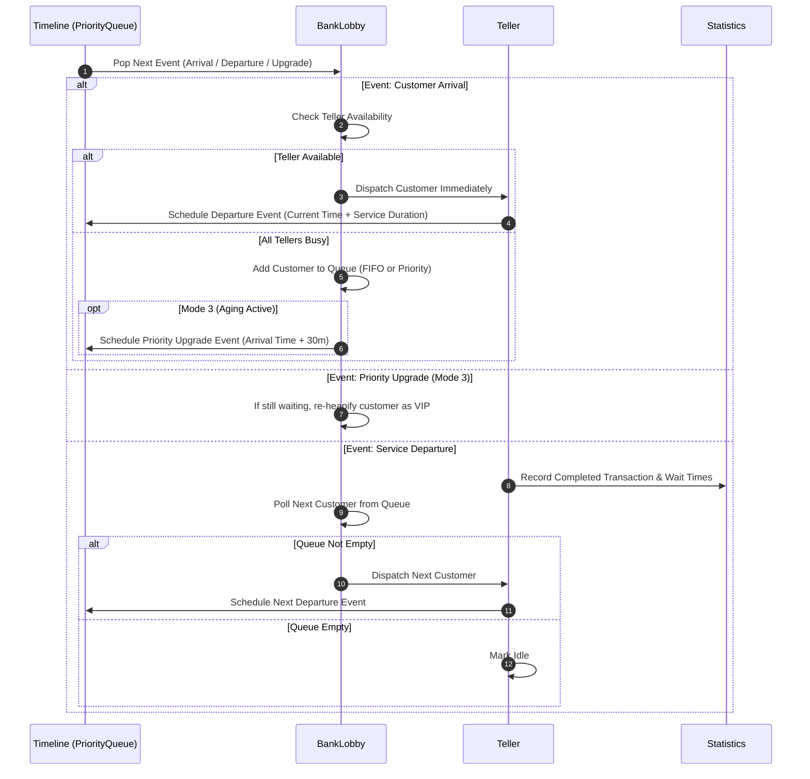

# Bank Queueing Simulation & Algorithm Evaluation System

A discrete-event simulation engine built in Java to model, evaluate, and benchmark queue management strategies in a retail banking environment.

---

## 1. Project Overview & Problem Statement

In service-oriented systems like retail banks, customer arrival surges create operational bottlenecks. Improper scheduling causes excessive wait times, customer churn, and uneven staff workload. Conversely, purely static priority schemes (e.g., favoring VIPs indefinitely) risk severe starvation of regular customers.

This project delivers an **Event-Driven Bank Queueing Simulation** designed to evaluate how different queue disciplines impact wait times, throughput, and server utilization. By running reproducible, seed-controlled trials across identical customer arrival profiles, the system directly quantifies trade-offs between standard fairness (FIFO), preferential treatment (Priority Queue), and starvation prevention (Aging Priority).

---

## 2. Core Queueing Modes

The simulation supports three switchable scheduling models:

```
[ Incoming Customers ]
          │
          ├──> Mode 1: FIFO (LinkedList) ───────────────> [ Available Tellers ]
          │
          ├──> Mode 2: Priority Queue (Min-Heap) ───────> [ Available Tellers ]
          │
          └──> Mode 3: Priority with Aging (Dynamic) ───> [ Available Tellers ]
                         │
                         └─(Wait >= 30m)─> Upgraded to VIP
```

### Mode 1: First-In, First-Out (FIFO)
* **Mechanics:** Customers are placed into a linear queue and served strictly in chronological order of arrival.
* **Characteristics:** Guarantees absolute temporal fairness; does not differentiate customer tier or transaction urgency.

### Mode 2: Priority Queue (VIP-First via Min-Heap)
* **Mechanics:** Orders customers using a two-tier comparator:
  1. **Customer Tier:** VIP customers precede regular customers.
  2. **Tie-Breaker:** Earliest arrival timestamp breaks ties within the same tier.
* **Characteristics:** Minimizes wait times for high-value clients, but exposes regular customers to potential starvation during sustained VIP arrivals.

### Mode 3: Aging Priority Algorithm
* **Mechanics:** Operates as a priority queue with dynamic escalation. A regular customer who waits in the lobby for 30 minutes triggers an aging transition event, elevating their tier to VIP status.
* **Characteristics:** Combines preferential service for high-tier customers with bounded latency guarantees, actively mitigating queue starvation.

---

## 3. Data Structures & Architectural Roles

| Data Structure | Java Implementation | Role in System | Algorithmic Justification |
|---|---|---|---|
| **FIFO Waiting Line** | `java.util.LinkedList` | Buffers customers in Mode 1. | Provides constant-time $O(1)$ insertions at the tail (`offer`) and removals from the head (`poll`). |
| **Priority Waiting Line** | `java.util.PriorityQueue` (Min-Heap) | Orders customers in Modes 2 and 3 based on composite priority. | Fast extraction of highest-priority customer ($O(\log N)$) with automatic re-heapification upon state changes. |
| **Discrete Event Timeline** | `java.util.PriorityQueue` | Schedules and delivers time-stamped simulation events chronologically. | Enables jump-to-next-event scheduling ($O(\log E)$) rather than inefficient fixed-step clock polling. |
| **Teller Performance Leaderboard** | `java.util.TreeSet` (Red-Black Tree) | Maintains a sorted ranking of tellers by completed transactions and utilization metrics. | Keeps teller rankings dynamically sorted at $O(\log T)$ cost per update without requiring a full sort pass. |
| **Service Catalog & Lookups** | `java.util.ArrayList` / Custom Arrays | Stores static service definitions (e.g., transaction types and service durations). | Guarantees deterministic $O(1)$ random-access lookups. |

---

## 4. Time Complexity Analysis

Let:
* $N$ = Current number of customers waiting in the lobby.
* $E$ = Number of scheduled events in the timeline queue.
* $T$ = Number of active tellers.

| Operation | Component | Underlying Data Structure | Time Complexity |
|---|---|---|:---:|
| Enqueue Customer (FIFO) | `BankLobby` | `LinkedList` | $O(1)$ |
| Dequeue Customer (FIFO) | `BankLobby` | `LinkedList` | $O(1)$ |
| Enqueue Customer (Priority) | `BankLobby` | `PriorityQueue` (Binary Heap) | $O(\log N)$ |
| Extract Next Customer (Priority) | `BankLobby` | `PriorityQueue` (Binary Heap) | $O(\log N)$ |
| Dynamic Customer Upgrade (Aging) | `BankLobby` | `PriorityQueue` (Remove + Re-insert) | $O(N)$ removal + $O(\log N)$ insert |
| Schedule Event | `Timeline` | `PriorityQueue` (Binary Heap) | $O(\log E)$ |
| Fetch Next Chronological Event | `Timeline` | `PriorityQueue` (Binary Heap) | $O(\log E)$ |
| Update Teller Leaderboard Position | `Statistics` | `TreeSet` (Red-Black Tree) | $O(\log T)$ |
| Assign Idle Teller | `BankLobby` | Array / Linear Scan | $O(T)$ |

---

## 5. Simulation Workflow

The engine uses a **Discrete-Event Simulation (DES)** model. The simulation clock does not advance tick-by-tick; it jumps directly to the timestamp of the next earliest event in the `Timeline`.



---

## 6. System Features

* **Configurable Simulation Parameters:** Custom teller counts, run durations (in simulation minutes), and queue modes.
* **Deterministic Execution:** Built-in pseudo-random seed support ensures experiments are fully reproducible across runs.
* **Heterogeneous Banking Services:** Models distinct transaction types with realistic processing times:
  * Balance Inquiry / Account Check (Short)
  * Cash Deposit / Withdrawal (Medium)
  * Loan / Mortgage Consultation (Long)
  * Account Opening / Onboarding (Extended)
* **Tiered Customer Demographics:** Automatic categorization into Regular and VIP tiers.
* **Real-Time Simulation Logging:** Console event stream showing customer arrivals, assignments, teller handoffs, aging triggers, and departures with timestamps.
* **Analytical Telemetry & Metrics:**
  * Average and maximum customer wait times (broken down by Regular vs. VIP).
  * Peak and average queue lengths.
  * Teller utilization rates, total customers served, and idle time distributions.
  * Auto-generated teller performance leaderboard.

---

## 7. Project Architecture & File Structure

```
├── src/
│   ├── BankLobby.java    # Manages customer queues (FIFO/Heap), teller pools, and dispatching
│   ├── Customer.java     # Customer entity (ID, tier, arrival time, service type, wait duration)
│   ├── Event.java        # Discrete simulation event model (Timestamp, EventType, Payload)
│   ├── Main.java         # CLI entry point, configuration parser, and simulation lifecycle driver
│   ├── Statistics.java   # Metric aggregation, waiting time analytics, and leaderboard compilation
│   ├── Teller.java       # Teller representation (ID, busy/idle state, transaction counter, service logic)
│   └── Timeline.java     # Priority-driven event scheduler driving the global simulation clock
```

---

## 8. Technologies & Concepts

* **Language:** Java (JDK 8 or higher)
* **Programming Paradigm:** Object-Oriented Programming (OOP) with clean separation of concerns.
* **Core Paradigms & Patterns:**
  * Discrete-Event Simulation (DES)
  * Producer-Consumer Queue Dynamics
  * Custom `Comparator<T>` implementations for composite heap ordering
* **Standard Library Collections:** `LinkedList`, `PriorityQueue`, `TreeSet`, `ArrayList`, `Map`

---

## 9. Installation & Execution

### Prerequisites
* Java Development Kit (JDK 8 or later)
* Git installed on your system

### 1. Clone the Repository
```bash
git clone https://github.com/your-username/bank-queueing-simulation.git
cd bank-queueing-simulation
```

### 2. Compile the Source Code
```bash
# From the project root
javac -d bin src/*.java
```

### 3. Run the Simulation
```bash
java -cp bin Main
```

*(Optional configuration parameters such as teller count, simulation duration, and queue mode can be adjusted directly via command-line arguments or prompts in `Main.java`.)*

---

## 10. Example Input & Output

### Sample Console Execution Log
```text
=== Bank Queueing Simulation Configuration ===
Queue Mode          : 3 (Priority with Aging)
Active Tellers      : 3
Simulation Duration : 120 minutes
Random Seed         : 42
--------------------------------------------------
[Time 00:02] ARRIVAL    : Customer #101 (Regular) requested Cash Deposit (Duration: 8m) -> Assigned to Teller #1
[Time 00:04] ARRIVAL    : Customer #102 (VIP) requested Loan Consultation (Duration: 25m) -> Assigned to Teller #2
[Time 00:05] ARRIVAL    : Customer #103 (Regular) requested Account Opening (Duration: 30m) -> Assigned to Teller #3
[Time 00:07] ARRIVAL    : Customer #104 (Regular) entered queue (All tellers busy).
[Time 00:10] DEPARTURE  : Customer #101 finished at Teller #1. Wait time: 0m.
[Time 00:10] DISPATCH   : Customer #104 pulled from queue -> Assigned to Teller #1.
[Time 00:15] ARRIVAL    : Customer #105 (VIP) entered queue.
[Time 00:20] ARRIVAL    : Customer #106 (Regular) entered queue.
[Time 00:50] AGING      : Customer #106 waited 30m -> Upgraded to VIP tier.
...
[Time 02:00] Simulation completed. Compiling report...
```

### Sample Performance Report
```text
==================================================
              SIMULATION METRICS REPORT           
==================================================
Total Customers Processed : 48
Regular Customers Served  : 36
VIP Customers Served      : 12
Upgraded via Aging (Mode 3): 4

Wait Time Statistics:
  Average Wait Time (Overall) : 7.42 mins
  Average Wait Time (VIP)     : 2.10 mins
  Average Wait Time (Regular) : 9.18 mins
  Maximum Wait Time           : 32.00 mins
  Peak Queue Size             : 6 customers

==================================================
           TELLER LEADERBOARD (TreeSet)           
==================================================
Rank  Teller ID   Customers Served   Active Time   Utilization
1     Teller #1   19                 108 mins      90.0%
2     Teller #2   16                 101 mins      84.2%
3     Teller #3   13                 94 mins       78.3%
==================================================
```

---

## 11. Planned Improvements

* **Graphical User Interface (GUI):** A JavaFX dashboard providing real-time queue length gauges and teller status indicators.
* **Specialized Teller Windows:** Configurable teller routing (e.g., dedicated commercial/VIP tellers or quick-service lines).
* **Multi-Server Multi-Queue (MSMQ):** Modeling separate per-teller physical lines to benchmark single-queue vs. multi-queue dynamics.
* **Metric Export:** Built-in CSV and JSON exporters for statistical analysis in Python/R.

---

## 12. Academic Acknowledgment

This project was designed and implemented as an academic project for a university-level **Data Structures & Algorithms** course. It highlights the practical engineering applications of linked structures, binary heaps, balanced search trees, and event scheduling mechanics in concurrent and operational system design.